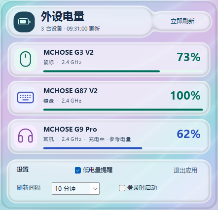
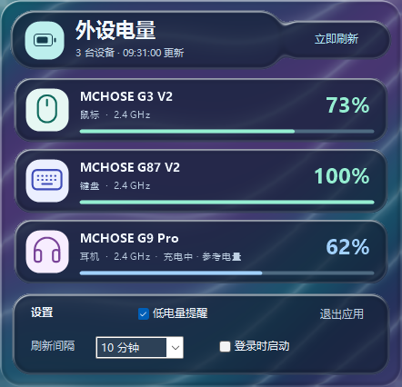

# Connector

Connector 收录两个独立的 Windows 工具。外设电量面向 Windows 10 2004+ x64，用一个免安装 exe 在任务栏显示无线设备电量；Clash Guard 管理本机代理节点。

- [外设电量](peripheral-power/) · Windows 任务栏电量显示 · [已发布版本](https://github.com/nhdzjiusan/Connector/releases)
- [Clash Guard](clash-guard/) · [下载脚本压缩包](https://github.com/nhdzjiusan/Connector/releases/tag/clash-guard-v1.0.0)

## 外设电量与隐私

外设电量从本机 HID 接收器和 Windows BLE 接口读取电量。应用无需管理员权限或额外驱动，运行时零网络请求、无遥测、不向服务端收集数据。设置、错误日志及手动生成的诊断文件留在本机。

| 浅色面板（示例读数） | 深色面板（示例读数） |
| --- | --- |
|  |  |

## 实机兼容设备矩阵

| 设备或接入方式 | 验证状态 | 支持范围 |
| --- | --- | --- |
| MCHOSE G3 V2 | 已实机读取 2.4 GHz 电量 | 内置无线与 USB 有线规则。同组有线优先已通过模拟验证。 |
| MCHOSE G87 V2 | 已实机读取 2.4 GHz 电量 | 内置接收器规则。 |
| MCHOSE G9 Pro | 已实机读取 2.4 GHz 电量 | 内置接收器规则。供电状态不明确时保留参考读数。 |
| 标准 BLE 外设 | 实现了标准协议，具体型号需实测 | 使用 Battery Service 的 Battery Level 特征。支持轮询，有 Notify 时尝试订阅。 |
| 其他私有 HID 外设 | 由规则作者实测 | 可在本机加载自定义 JSON 电量规则，先用脱敏帧离线验证。[规则格式与加载路径](peripheral-power/docs/hid-rules.md) |

## 下载与验证

在 [Releases](https://github.com/nhdzjiusan/Connector/releases) 选择以 `peripheral-power-v` 开头的标签。新版附件由版本化 exe 及同名 `.sha256` 组成。例如运行 `certutil -hashfile PeripheralPower-1.2.2-win-x64.exe SHA256`，逐字比对同一 Release 校验文件中的哈希。下载后可直接在普通用户账号运行。

## 贡献与许可

设备问题请使用故障模板并脱敏诊断文件。提交改动请说明设备、连接方式与验证步骤，并在 Windows 上运行 `dotnet run -c Release --project tests/peripheral-power/PeripheralPower.Check.csproj`。[逐项验收清单](peripheral-power/docs/acceptance.md)

本仓库的原创代码采用 [MIT 许可证](LICENSE)。第三方组件按各自的许可证分发，见 [HidSharp 许可说明](peripheral-power/HidSharp-LICENSE.txt)。
