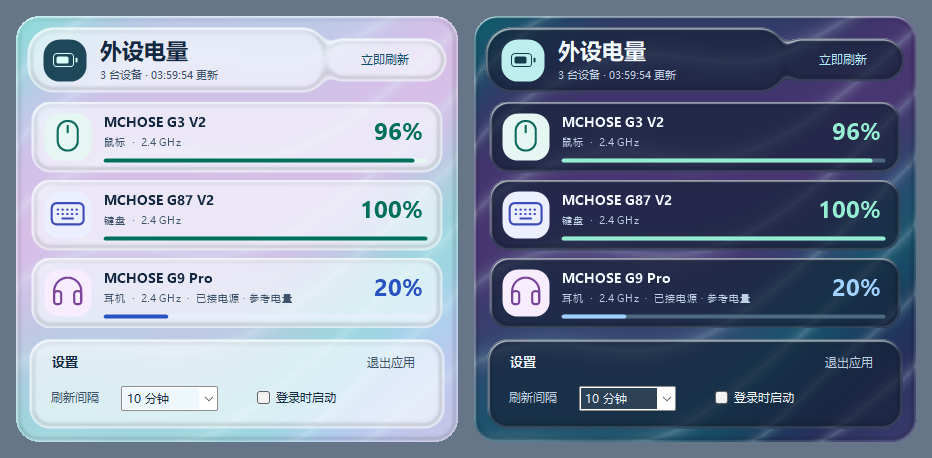

# 外设电量

Windows 10 2004 及更新版本的 x64 托盘应用。独立发布的可执行文件可直接双击运行。

[查看 GitHub Releases 中可下载的 Windows 版本](https://github.com/nhdzjiusan/Connector/releases)

- 本地任务栏版在主屏任务栏空白处显示设备图形和百分比，优先靠近通知区域。单击显示条打开原详情面板，右键可立即刷新或退出。
- 数字低于 15% 变红；充电显示蓝色闪电，确认已充满并接电时显示绿色对勾。G9 Pro 接电时可能只提供参考百分比，满电标识使用耳机独立的满电状态。仅提供百分比的蓝牙设备只显示电量。
- 刷新间隔可选 5–15 分钟，默认 10 分钟。可随时手动刷新，接收器插拔和系统从睡眠恢复也会触发刷新。
- 勾选「登录时启动」后，Windows 登录时会静默启动。请从计划长期保留的位置运行程序，再开启这项设置。
- 读不到电量的外设不占托盘位置。所有设备都没有读数时，保留应用入口，方便打开设置和手动重试。
- 空间不足以容纳所有设备时，显示条每四秒轮换。全屏、任务栏隐藏或没有可用空间时，显示条收起，保留通知区域入口。

## 液态玻璃弹窗

弹窗跟随 Windows 应用深浅色主题。设备数据与背景分层绘制，接电参考值会直接标在设备名称下方。

[开发设计规范](液态玻璃设计规范.md)

## 兼容范围

内置 2.4 GHz 接收器协议为 MCHOSE G3 V2、G87 V2 和 G9 Pro。蓝牙设备需要支持标准 BLE Battery Service，并提供可识别的鼠标、键盘或耳机类型。休眠、关机、超出接收范围或使用未支持协议的设备可能不返回电量。

已在实机上读到 G3 V2、G87 V2 和 G9 Pro 的电量。G9 Pro 接电时，接收器可能持续回传插线前的百分比，卡片会标记「已接电源 · 参考电量」。换用其他 2.4 GHz 接收器时，可在 UsbBattery.cs 中加入对应的 USB 标识和电量读取协议。

## 构建

程序移动后，使用新位置的 exe 重启一次即可修正已开启的登录自启。右键显示条或托盘图标可以选择保留自启退出，或“退出并关闭自启”。面板“退出应用”保留当前登录设置。

### 验证下载

从同一 Release 下载 `PeripheralPower-1.2.0-win-x64.exe` 和同名的 `.exe.sha256`（按所选版本替换 1.2.0）。在下载目录运行 `certutil -hashfile PeripheralPower-1.2.0-win-x64.exe SHA256`。忽略大小写和空格，对比结果与校验文件第一列的全部 64 个十六进制字符，一致后再运行。版本化命名适用于新流水线发布的附件。

在 Windows 安装 .NET 10 SDK，在项目目录运行以下命令。

    dotnet publish -c Release -r win-x64 --self-contained true -p:PublishSingleFile=true -p:IncludeNativeLibrariesForSelfExtract=true -p:EnableCompressionInSingleFile=true

可在构建目录运行下面的命令生成一次设备读取结果。

    PeripheralPower.exe --scan scan.json

USB HID 访问使用 [HidSharp](https://www.nuget.org/packages/HidSharp)。
G3 V2 和 G9 Pro 的协议参考 [OpenMHub](https://github.com/brayanspagnol/OpenMHub)，G87 V2 的协议参考 [mchose-battery](https://github.com/Tensyd/mchose-battery)。
