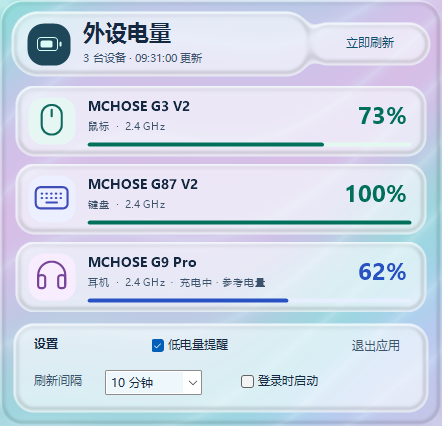

# 外设电量

Windows 10 2004 及更新版本的 x64 托盘应用。独立发布的可执行文件可直接双击运行。

[查看 GitHub Releases 中可下载的 Windows 版本](https://github.com/nhdzjiusan/Connector/releases)

- 本地任务栏版在主屏任务栏空白处显示设备图形和百分比，优先靠近通知区域。单击显示条打开原详情面板，右键可立即刷新或退出。
- 数字低于 15% 变红；充电显示蓝色闪电，确认已充满并接电时显示绿色对勾。G9 Pro 接电时可能只提供参考百分比，满电标识使用耳机独立的满电状态。仅提供百分比的蓝牙设备只显示电量。
- 刷新间隔可选 5–15 分钟，默认 10 分钟。可随时手动刷新，接收器插拔和系统从睡眠恢复也会触发刷新。
- 勾选「登录时启动」后，Windows 登录时会静默启动。请从计划长期保留的位置运行程序，再开启这项设置。
- 临时读取失败会显示上次百分比及采样时间。设备变化事件后，成功枚举确认设备已移除才删除对应读数。首次启动还没有读数时保留应用入口。
- 空间不足以容纳所有设备时，显示条每四秒轮换。全屏、任务栏隐藏或没有可用空间时，显示条收起，保留通知区域入口。

## 液态玻璃弹窗

弹窗跟随 Windows 应用深浅色主题。设备数据与背景分层绘制，接电参考值会直接标在设备名称下方。

[开发设计规范](液态玻璃设计规范.md)

## 兼容范围

| 设备 | 连接 | 已验证 | 已知限制 |
| --- | --- | --- | --- |
| MCHOSE G3 V2 | 2.4 GHz / 已登记的 USB 端点 | 实机曾读取无线电量 | 状态 1 也可能是休眠；插线切换时保留上次时间，直到新端点返回数据 |
| MCHOSE G87 V2 | 2.4 GHz | 实机曾读取电量 | 接收器在线时键盘仍可休眠 |
| MCHOSE G9 Pro | 2.4 GHz | 实机曾读取电量 | 状态 3 为充电参考值，4 为满电；状态 0 无法确认已接电 |
| 标准 BLE Battery Service | 已连接的 BLE 外设 | 已实现；本轮缺独立 BLE 实机 | 需可读 Battery Level；未识别类型使用通用图标，优先使用 Windows 缓存 |

内置范围仅为上述三款迈从和标准 BLE。其他品牌、固件和接收器组合不保证兼容。

## 退出、自启和卸载

程序移动后，使用新位置的 exe 重启一次即可修正已开启的登录自启。右键显示条或托盘图标可以选择保留自启退出，或“退出并关闭自启”。面板“退出应用”保留当前登录设置。

### 卸载和通知区域

卸载时选择“退出并关闭自启”，确认进程已结束，删除 exe。如需清除设置和日志，再删除 `%LOCALAPPDATA%\PeripheralPower`。若已先退出，可从原位置启动一次，关闭自启再退出。

显示条找不到可用空间时，使用逐设备托盘图标。Windows 决定哪些图标收进通知区域的折叠区，点击时钟旁的 **∧** 展开。系统任务栏设置可以固定图标。

## 设置、诊断与隐私

应用完全本地运行。`%LOCALAPPDATA%\PeripheralPower\settings.json` 保存 interval（5–15 分钟）、startup、notifications、theme（system/light/dark）。自启以当前用户 Windows Run 项为准。首次生成 JSON 时迁移旧 interval.txt；保存先写临时文件再原子替换。手动修改主题前请先退出应用。

首次启动时，.NET 可能向当前用户的临时目录解压本机组件，请保留可写的临时空间。低电提醒默认开启，设置区可关闭。20%、10%、5% 每档每次放电最多提示一次；一次跌过多档只提示当前档。

错误日志位于 `%LOCALAPPDATA%\PeripheralPower\logs\error-YYYY-MM-DD.log`，单文件最多 1 MiB，当天前一卷为 `.log.1`。`--scan <已存在目录中的文件.json>` 写出读取结果和诊断明细；partial 为 true 表示结果不完整。反馈前请遮盖设备标识、序列号、用户名和个人路径。

可选的 `%LOCALAPPDATA%\PeripheralPower\protocols.json` 为数组。每项指定十进制整数 vendor、product、usage，名称 name 和类型 kind（Mouse、Keyboard、Headset）。usage 为 Usage Page 左移 16 位再加 Usage。仅应加入已确认使用同一内置协议的设备。启动时合并白名单，重复项优先内置配置。文件只做固定电量协议匹配，不执行脚本或自定义报文。缺失时使用内置表；格式错误时回退并记错。

## 验证下载与签名

从同一 Release 下载 `PeripheralPower-1.2.0-win-x64.exe` 和同名的 `.exe.sha256`（按所选版本替换 1.2.0）。在下载目录运行 `certutil -hashfile PeripheralPower-1.2.0-win-x64.exe SHA256`。忽略大小写和空格，对比结果与校验文件第一列的全部 64 个十六进制字符，一致后再运行。版本化命名适用于新流水线发布的附件。

发布流程未配置 Authenticode 签名。可用 `Get-AuthenticodeSignature .\PeripheralPower-1.2.0-win-x64.exe` 检查具体文件。遇到杀软告警时先核对来源和哈希，保留告警名，通过安全软件厂商误报渠道复核。当前没有已验证的 VirusTotal 扫描结论；可在其网站搜索对应附件的 SHA-256。没有报告应记录为“未知”。

## 构建与发布

本轮本地候选 exe 的 Authenticode 检查结果为 `NotSigned`，SHA-256 为 `3cd1487be2dc6d4832b95fa5de3b0c72f3a7556014a2ca9d1f31d60e833223fc`。本轮未取得可核实的 VirusTotal 检测结果。[按该候选文件的哈希查询](https://www.virustotal.com/gui/file/3cd1487be2dc6d4832b95fa5de3b0c72f3a7556014a2ca9d1f31d60e833223fc)。Actions 构建可能生成不同哈希，请以实际下载的校验附件为准。

在 Windows 安装 .NET 10 SDK，在项目目录运行以下命令。

    dotnet publish -c Release -r win-x64 --self-contained true -p:PublishSingleFile=true -p:IncludeNativeLibrariesForSelfExtract=true -p:EnableCompressionInSingleFile=true

可在构建目录运行下面的命令生成一次设备读取结果。

    PeripheralPower.exe --scan scan.json

USB HID 访问使用 [HidSharp](https://www.nuget.org/packages/HidSharp)。
推送形如 `peripheral-power-v1.2.0` 的新标签会运行 Windows 工作流，验证项目版本和回归检查，上传 exe 与校验附件。重跑同一标签可更新附件。[逐项验收](docs/acceptance.md) · [变更记录](../CHANGELOG.md)
G3 V2 和 G9 Pro 的协议参考 [OpenMHub](https://github.com/brayanspagnol/OpenMHub)，G87 V2 的协议参考 [mchose-battery](https://github.com/Tensyd/mchose-battery)。
